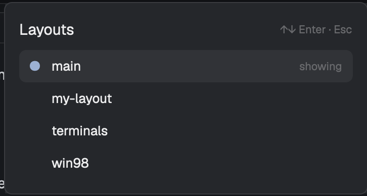

# herdr-layout-picker

A [Herdr](https://herdr.dev) mod: Cmd+Shift+L opens a list of your layouts,
with the one showing marked, instead of cycling to the next one blind.



## Install

Ask your agent: *"add the Herdr mod at github.com/rstudner/herdr-layout-picker"*.
Or by hand:

```sh
cp -r mods/layout-picker ~/.config/herdr-app/mods/
herdr-app check ~/.config/herdr-app/mods/layout-picker
```

Then merge [keys.json](keys.json) into `~/.config/herdr-app/keys.json`
(`cmd-shift-l` → `mod.open:layout-picker`).

## What it reaches

Nothing outside Herdr: no network, no programs, no files.

MIT licensed.
