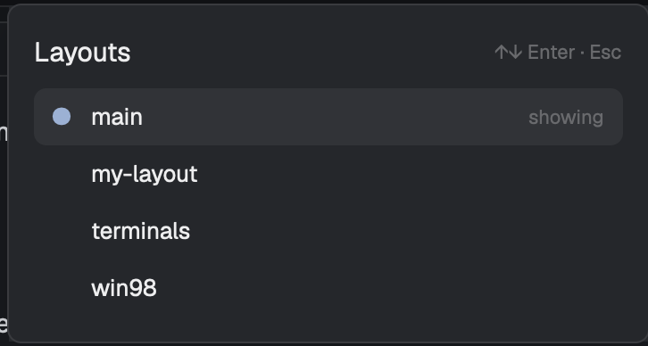

# Layout picker

A small popup that lists every Herdr layout, marks the one showing, and
switches to the one you click or pick with the arrow keys and Enter. It
replaces `layout.switch`'s blind cycling, so you see where you're going.

## What you see

- A popup (`kind: "popup"`, `at: "top"`, 40 px down), 360 × 320, on the
  theme's `popover`, 14 px padding, text 13 px.
- **Header**: "Layouts" (15 px, semibold, `foreground`) on the left,
  "↑↓ Enter · Esc" (11 px, `dim`) on the right.
- **The list**, scrolling when long: one 32 px row per layout name, sorted
  A–Z, radius 7, 10 px side padding. The layout showing has an `accent` "●"
  in a 12 px column, its name semibold, and "showing" (11 px, `dim`) at the
  right. The highlighted row and the row under the pointer are on `hover`.
- **No layouts** (never in practice): "No layouts found." in `dim`.

## How it behaves

- Cmd+Shift+L (`mod.open:layout-picker`) opens it; again closes it.
- It opens with the showing layout highlighted.
- ↑/↓ move the highlight (wrapping); Enter or a click switches with
  `layout.switch {name}` and closes; picking the layout already showing just
  closes. Esc closes.
- Agent status isn't shown: the picker is about layouts only.

## Built from

- **One mod**, `mods/layout-picker/`:
  - `main.js`: the view;
  - `mod.json`: `{ "place": "none", "title": "Layouts", "overlay": { "kind":
    "popup", "at": "top", "offset": 40, "width": 360, "height": 320 } }`.
- **One key**, `keys.json`: `"global": { "cmd-shift-l":
  "mod.open:layout-picker" }`, replacing `layout.switch` on that key.
- `herdr` functions: `layouts()` (names), `shared("layout")` (the one
  showing), `run("layout.switch", { name })`, `theme`, `props`,
  `closeOverlay`.
- No programs, no network, no files.

## Watch out

- A popup with no input needs its own focus handle: `track_focus` on the
  root and `handle.focus()` shortly after `init` (a 50 ms timer), or the
  arrow keys go nowhere.
- Give the list an explicit height (32 px per row, at most 240) instead of
  `flex_1`: the popup sizes to its content, so a flex list gets no height
  and the popup shows only its header.
- `layouts()` order isn't guaranteed; sort it so the list doesn't shuffle.

## Done when

- `herdr-app check mods/layout-picker` passes.
- Cmd+Shift+L shows every file in `layouts/`, the showing one marked.
- ↓ then Enter switches to the next layout and the popup closes.
- Clicking the showing layout closes the popup without switching.
- Esc closes it.
